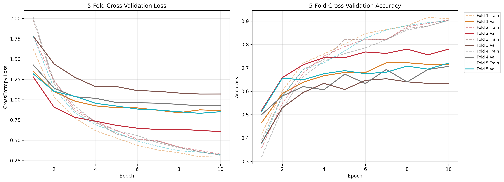
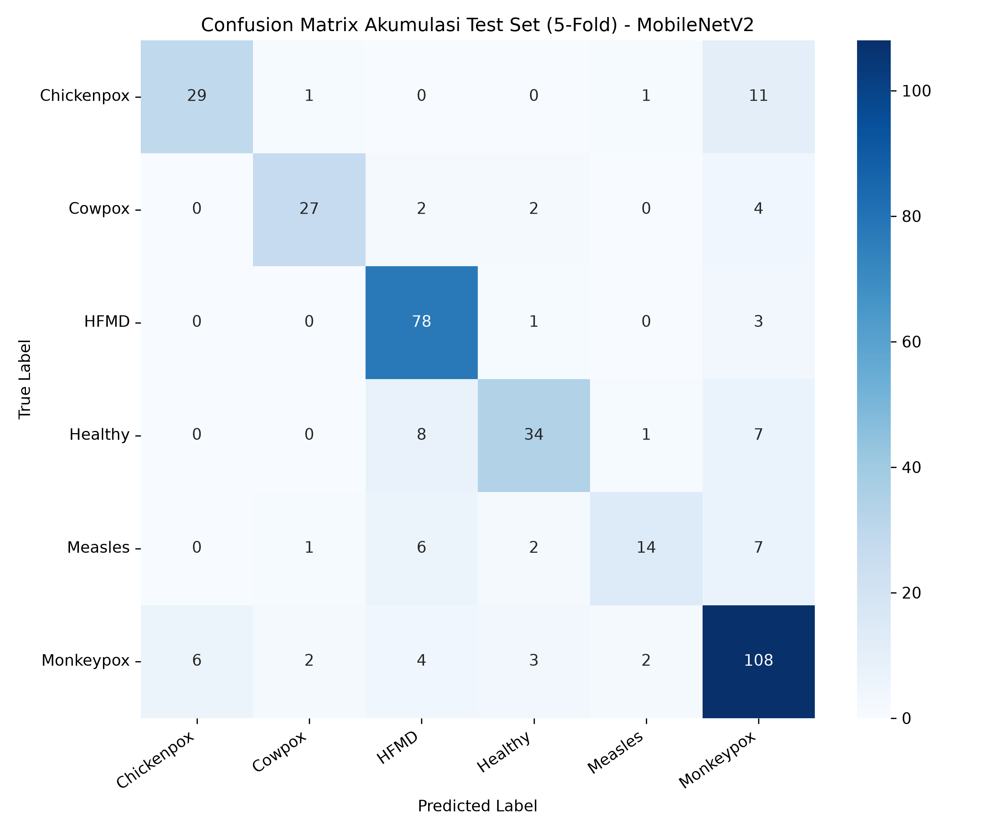

# Klasifikasi Monkeypox Multi-Model (5-Fold Cross-Validation)

Repositori ini dibuat untuk memenuhi tugas Mata Kuliah Infrastruktur dan Platform Sains Data (IPSD) oleh **Kelompok 4**:
- **Faatin Jamiilatul Hasanah** (108102500037)
- **Nabila Amanda Fijienisa** (108102500036)
- **M. Albani Mufti Radja T** (108102530013)

Eksperimen ini melakukan klasifikasi citra lesi kulit pada *Monkeypox Skin Lesion Dataset Version 2.0* (MSLD v2.0) (6 kelas: *Chickenpox*, *Cowpox*, *HFMD*, *Healthy*, *Measles*, dan *Monkeypox*) menggunakan tiga arsitektur *deep learning* yang dievaluasi pada skema **5-Fold Cross-Validation** (`fold1` – `fold5`)

---

## Ringkasan Model
1. **Simple CNN**: Arsitektur CNN dasar (*baseline*) untuk melatih representasi fitur citra secara langsung[cite: 6].
2. **Modified CNN**: Pengembangan arsitektur CNN dengan modifikasi lapisan dan regularisasi *Dropout*[cite: 3, 6].
3. **MobileNetV2**: Pendekatan *transfer learning* berbasis bobot pra-latih `imagenet` (`trainable = False`, `GlobalAveragePooling2D`, `Dropout(0.2)`, dan lapisan `Dense` keluaran `softmax`)

---

## Ringkasan Hasil Evaluasi (5-Fold Test Set)

### Rata-Rata 5-Fold pada Data Test
| Model | Accuracy (Mean ± Std) | Precision (Macro) | Recall (Macro) | F1-Score (Macro) | ROC-AUC |
| :--- | :---: | :---: | :---: | :---: | :---: |
| Simple CNN | 0,450 | 0,427 | 0,353 | 0,342 | 0,779 |
| Modified CNN | 0.466 | 0.445 | 0.300 |	0.286 |	0.734 |
| MobileNetV2 | 0,747 | 0,790 | 0,695 | 0,712 | 0,939 |

### Accuracy Per Fold (Test / Validation)
| Model | Fold 1 (Test / Val) | Fold 2 (Test / Val) | Fold 3 (Test / Val) | Fold 4 (Test / Val) | Fold 5 (Test / Val) |
| :--- | :---: | :---: | :---: | :---: | :---: |
| Simple CNN | 0,432 | 0,500 | 0,500 | 0,580 | 0,476 |
| Modified CNN | 0.463 |	0.390 |	0.266 |	0.247 |	0.671 |
| MobileNetV2 | 0,711 | 0,737 | 0,653 | 0.6787 | 0,939 |

---

## Visualisasi Hasil



---

## Struktur Proyek
```text
MonkeyPox-Classificatiob-Tim-4/
├── assets/
│   ├── 5fold_training_curves_MobileNetV2.png
│   └── cm_akumulasi_5fold_MobileNetV2.png
├── Data/                                # Dataset lokal (tidak diunggah ke Git)
├── Models/                              # Model tersimpan (.h5) & skrip pelatihan
├── Utils/                               # Skrip utilitas / evaluasi tambahan
├── hasil_5fold_Simple_CNN.csv
├── hasil_5fold_Modified_CNN.csv
├── hasil_5fold_MobileNetV2.csv
├── evaluate_5fold.py
├── evaluate_models.py
├── train_5fold_curves.py
└── README.md
---
## Catatan & Keterbatasan
- **MobileNetV2** memberikan performa terbaik secara keseluruhan pada eksperimen ini, sementara **Modified CNN** belum melampaui **Simple CNN** pada seluruh metrik evaluasi.
- Terdapat indikasi *overfitting* pada kurva pelatihan (akurasi *training* meningkat lebih tinggi dibanding *validation* seiring *epoch*) serta ketidakseimbangan jumlah sampel antar-kelas (terutama kelas minoritas seperti *Measles*)[cite: 9, 10].
- Ukuran citra yang digunakan adalah `128x128` dengan `BATCH_SIZE = 32` dan `EPOCHS = 10`[cite: 2, 3, 4].
